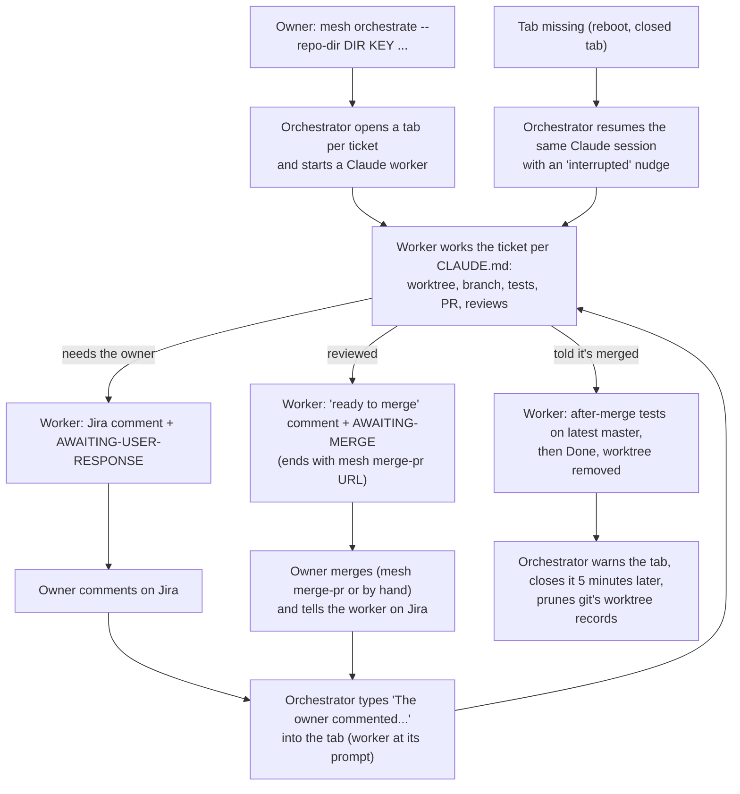

# mesh orchestrate (v1, PMAT-281)

Runs one Claude session per Jira ticket, each in its own tmux tab, and does what the owner would otherwise
do by hand in those tabs.

- **Each Claude session is a worker.** It runs its ticket itself through the Claude harness (`CLAUDE.md`
  and the files it links): worktree, branch, labels, PR, review, "ready to merge", and Done after the
  merge. A session started by hand works the same way.
- **The mesh orchestrator** opens and reopens the workers' tabs, reads Jira, and types
  into a worker's tab what the owner would type. It never writes to Jira, so each ticket's labels have one
  writer: its worker.
- **The owner is the team lead.** They answer workers' questions, merge PRs (by hand or with `mesh merge-pr`)
  and tell the workers, on Jira or in the tabs.

## Workflow



## Usage

Run it in its own tmux tab. Tickets named on the command line start in `--repo-dir`, the local folder of their
repo (its root). It is required with tickets, so a ticket never starts in whatever folder you happen to be in:

```bash
mesh orchestrate --repo-dir ~/environment/pmat/alpha-mesh PMAT-282 PMAT-283   # start a worker per ticket
mesh orchestrate                     # after a reboot: reopen and resume the workers, then keep watching
```

Options: `--repo-dir DIR` (required with tickets), `--interval SECONDS` (default 30).

Tickets from several repos: a running ticket keeps the folder it started in (its PRs are looked up there), so
to add tickets from another repo, Ctrl-C and run `mesh orchestrate --repo-dir ~/environment/pmat/<other-repo> KEY ...`.
Each worker first checks that its ticket belongs to the repo it was started in, and asks on Jira if not.

Only one copy runs at a time (a lock in `~/environment/logs/orchestrator/`): a second `mesh orchestrate`
says so and exits, since two would both type into the same tabs. Stopping it (Ctrl-C) and starting it again is
safe at any time; it picks up from the status files, Jira, GitHub and tmux.

Each tick, per ticket:

| Seen | Done |
| --- | --- |
| The ticket's tab is missing (reboot, closed tab) | Reopen it and resume the worker (`claude --resume <id>`) in the folder it started in, telling it it was interrupted |
| A new owner comment (no `MESSAGE-FROM-WORKER` marker), whatever the labels: an answer, a rejected merge, feedback | Type "The owner commented on Jira …: comments after X, newest Y" into the tab, once per new comment (X: the last one passed on). Comments from before the worker started are not passed on |
| The ticket is Done, with no `AWAITING-USER-RESPONSE`, and the worker is at its prompt | Type a warning into the tab: it closes in 5 minutes unless the owner types something there |
| 5 minutes after that warning, and nobody typed in the tab | Close the tab, then `git worktree prune` in the ticket's repo folder: the worker removed its worktree inside its sandbox, which can't delete git's record of it (`.git/worktrees/<name>`) |
| The owner typed in the tab after the warning | Leave the tab open and stop watching the ticket: it is the owner's now |

It types into a tab only when the worker sits at its prompt (hook state `idle` or `waiting`). Each ticket
is handled on its own: an error on one (a tab closed mid-tick, `gh` offline) is printed and retried next
tick, and the others carry on. 
### The screen

Redrawn in place each tick, as three boxes (colour when run in a terminal; the header counts down to the next
check each second):

```
┌─ mesh orchestrate ───────────────────────────────────────────────────────────────────────────────┐
│ 2 workers · checked 16:12:28 · next check in 30s                                                 │
└──────────────────────────────────────────────────────────────────────────────────────────────────┘
┌─ Workers ────────────────────────────────────────────────────────────────────────────────────────┐
│ TICKET    WORKER   FOR  JIRA  PR                                                NEEDS YOU        │
│ ──────────────────────────────────────────────────────────────────────────────────────────────── │
│ PMAT-284  working  3m   open  -                                                                  │
│ PMAT-285  idle     1m   open  https://github.com/bbomt/alpha-mesh/pull/26 open  ▶ merge PR #26   │
└──────────────────────────────────────────────────────────────────────────────────────────────────┘
┌─ Recent ─────────────────────────────────────────────────────────────────────────────────────────┐
│ 16:12:28  PMAT-285: started a worker in tab PMAT-285                                             │
└──────────────────────────────────────────────────────────────────────────────────────────────────┘
```

- **WORKER / FOR:** the hook state (`working`, `idle`, `waiting`, or `tab missing`) and how long since it changed.
  `waiting` means a prompt in the tab (e.g. a permission); Claude's notice after a minute at the prompt shows as
  `idle`. A worker whose turn has ended while a background command it started still runs shows as `working`:
  Claude has no hook for that, so the orchestrator looks for a child shell (`bash`, or `bwrap` when sandboxed)
  under the tab's `claude` process. So `working` = busy, `waiting` and NEEDS YOU = you are needed, `idle` = at
  its prompt with nothing running.
- **PR:** the URL and state of the newest PR with the ticket key in its title (`gh`, one call per ticket per tick).
- **Colours:** ticket keys yellow, Done green, PR URLs blue; owner actions bold yellow, problems red, working
  workers green, idle ones dim.
- **NEEDS YOU** (shown only while the worker is at its prompt; a working worker isn't waiting on you): `▶ answer on Jira`, `▶ merge PR #N` (then `▶ tell the worker PR #N is merged`), `▶ check the tab: <message>` (a permission prompt or any
  notification other than the 60-second idle one), the close countdown, or `resuming the worker`.
- **Recent:** the last 10 events, newest first, each cut to 110 characters so the boxes stay one screen wide. Every event is also appended to
  `~/environment/logs/orchestrator/events.log`, and the last 10 are shown again after a restart.

**Orchestrated workers get a system prompt** (`worker-prompt.md`, passed with `--append-system-prompt-file`
on every start and resume). It is the only difference from a manual session:

- ask the owner on Jira (a comment, then `AWAITING-USER-RESPONSE`) and wait, taking the answer from Jira or the tab,
  and remove the label as soon as it has read the answer (before acting on it), so `▶ answer on Jira` goes at once;
- start every Jira comment with `MESSAGE-FROM-WORKER` (workers and the owner post from the same Jira
  account, so a comment without the marker is taken as the owner's);
- always work in a git worktree (at `.claude/worktrees/<TICKET>`, per `CLAUDE_GLOBAL.md`), never in the checkout all
  workers start from.

Manual sessions ask in the chat only, so manual tickets get no extra Jira comments. The owner can take over
a worker by answering in its tab and telling it not to post to Jira.

## Files

- `worker-prompt.md`: the system prompt every orchestrated worker gets.
- `src/orchestrator/loop.py`: start a worker, one tick, the status table.
- `src/orchestrator/jira.py`: read-only Jira through the Atlassian MCP server (`https://mcp.atlassian.com/v2/mcp`).
- `src/orchestrator/status.py`: the per-ticket status files, `~/environment/logs/orchestrator/<KEY>.json`,
  shared with the hooks under the same lock.
- `src/orchestrator/tmux.py`: the tabs, named by ticket key, in the tmux session the orchestrator runs in.
- `settings.json`: the settings every worker is started with (`--settings`):
  - the status hooks (`SessionStart` → started, `UserPromptSubmit` → working, `Stop` → idle,
    `Notification` → waiting), each running `status-hook.sh`;
  - the Atlassian plugin;
  - what a worker needs to work inside its sandbox without approvals: write access to `~/.mesh` (review
    locks and checkpoints), `~/.cache/uv` and pnpm's store, cache and state folders, and the hosts it reaches
    (GitHub, openrouter.ai, PyPI, the npm registry, and the AWS SSO, STS, SSM, DynamoDB and S3 endpoints in
    eu-west-1).
  Settings load when a worker starts or resumes, so a running worker gets a change only after a restart.
- `status-hook.sh <state>`: the hook. It reads the hook input on stdin and writes the session's state to
  `~/environment/logs/orchestrator/$ORCH_TICKET.json` (state, session ID, worktree, transcript, notification
  type, history; the full `SessionStart` input as `session_start_input`), under the same lock as the
  orchestrator. Tested by `test/test-orchestrator-status-hook`.
- Tests: `tests/`, run by `test/test-orchestrator`.
  - Unit tests: the decisions, the screen and the CLI, with fake tmux, gh and Jira.
  - `test_e2e.py`: the real `mesh orchestrate` loop, one check at a time (each check is also a restart), against
    real tmux on its own server (`-f /dev/null`, so the owner's tabs and config are untouched) and
    `tests/claude-stub`, a stand-in `claude` that runs the real status hook and logs what is typed into it.
    Jira and gh are faked. It covers start, passing on a comment, resume after the tab is killed, and
    warn-then-close.

## Atlassian login

The first run prints a link. Open it in a **fresh** browser tab (a reused tab fails with
`invalid_request`), choose the site, accept, and paste back the URL the browser ends on
(`http://localhost:8765/callback?...`; the page itself fails to load). The login is saved in
`~/.config/alpha-mesh/atlassian-oauth.json` (mode 600) and refreshed, so this is needed once.

The consent page lists every permission the server offers (about 30, all apps). It cannot be narrowed to
Jira: unticking narrows only by read/write/search across all apps, and a Jira-only request is rejected.
The orchestrator itself only reads.

## Security: external commands

The orchestrator drives programs, not libraries: `tmux` (the tabs), `claude` (started by tmux), `gh` (PRs),
`git` and `ps`, so it runs them with `subprocess`. The rules that keep that safe:

- Every call passes a list of arguments; none uses `shell=True`.
- Ticket keys must look like `PMAT-282` (letters, a dash, digits), or nothing starts. A key becomes a tab name, a
  status file name (`~/environment/logs/orchestrator/<KEY>.json`) and part of the `claude ...` command tmux
  runs, so `../x` or `PMAT-1;rm -rf ~` must never get through.
- The one string a shell runs (the `claude ...` command in the new tab) quotes every value with `shlex.quote`.
- Text typed into a tab is a fixed template plus Jira comment IDs, sent with `send-keys -l` (literally).

## Limits (v1)

- Only tabs it started: a session started by hand is not watched.
- Merges are not watched: the owner merges (by hand, or with the `mesh merge-pr <url>` command the worker's
  "ready to merge" comment ends with; it refuses a stale branch), then tells the worker with a Jira comment
  (passed on like any other) or in its tab. The PR column shows the PR's state.
- PRs are found by the ticket key in brackets in the title (`feature[PMAT-282]: …`), from the repo's last 100 PRs.
- Typing into a tab is one try; if the worker is busy, it waits for the next tick.
