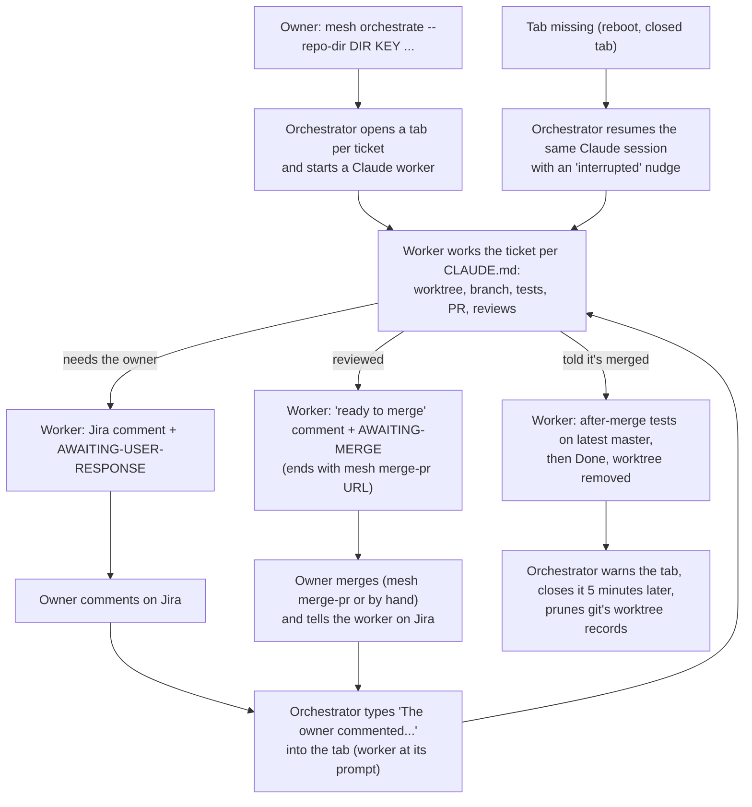

# mesh orchestrate (v1, PMAT-281)

Runs one Claude session per Jira ticket, each in its own tmux tab, and does what the owner would otherwise
do by hand in those tabs.

- **Each Claude session is a worker.** It runs its ticket itself through the Claude harness (`CLAUDE.md`
  and the files it links): worktree, branch, labels, PR, review, "ready to merge", and Done after the
  merge. A session started by hand works the same way.
- **The mesh orchestrator** opens and reopens the workers' tabs, reads Jira, and types
  into a worker's tab what the owner would type. It never writes to Jira, so each ticket's labels have one
  writer: its worker.
- **The owner is the team lead.** They answer workers' questions, merge PRs (by hand or with `mesh merge-pr`)
  and tell the workers, on Jira or in the tabs.

## Workflow



## Working rules

The process has three roles: the team lead, the workers and the orchestrator. Most of the rules below live in
`CLAUDE_GLOBAL.md` and `CLAUDE_ENGINEERING.md` (`pmat/architecture/`) and in `worker-prompt.md`; this section
sums them up as they stood on 2026-10-23.

### Team lead (the owner)

- **Starts tickets:** `mesh orchestrate --repo-dir <the repo's local folder> KEY ...`. Plain `mesh orchestrate`
  picks up the running workers after a restart or reboot. Restarting the orchestrator is always safe.
- **Answers on Jira** (or in the worker's tab). Any comment without the `MESSAGE-FROM-WORKER` marker counts as
  the team lead's, and the orchestrator passes it on.
- **Merges.** Only the team lead merges, with `mesh merge-pr <PR url>` (the command each "ready to merge" comment
  ends with) or by hand. `mesh merge-pr` refuses a branch that lacks the latest default branch; the team lead
  then asks the worker to refresh. After merging, the team lead tells the worker "merged" on Jira.
- Doesn't rely on GitHub settings (branch protection) for safety.

### Worker (one Claude session per ticket)

- **Checks first** that the ticket belongs to the repo it was started in; if not, asks on Jira.
- **Branches from the latest remote default branch** (`git fetch`, then `origin/<default>`), in its own worktree at
  `<repo>/.claude/worktrees/<KEY>`. The main checkout always stays on the default branch.
- **Merges `origin/<default>` in before every push** (merge, never rebase a pushed branch), reruns the tests,
  then pushes. Conflicts in another ticket's work go to the team lead.
- **Shares one test environment** (the AWS dev environment and this machine's ports): every deploy, and every test
  run that deploys or starts a server, runs under `flock /tmp/claude-1000/pmat-test-env.lock`, one at a time.
- **Reviews its own PR** with `mesh review-pull-request`, inside its sandbox, with the free models in the order
  `CLAUDE_ENGINEERING.md` lists, until no confirmed HIGH or MEDIUM findings remain; false findings go to PMAT-269.
- **Talks on Jira:** every comment starts with `MESSAGE-FROM-WORKER`. To ask, it posts a comment and adds
  `AWAITING-USER-RESPONSE`, then waits. It removes that label **as soon as it reads the answer**, before acting.
- **Ready to merge:** a "ready to merge" comment ending with `mesh merge-pr <PR url>`, and `AWAITING-MERGE`.
- **When told "merged":** removes `AWAITING-MERGE` at once, runs the tests on the latest default branch in its
  worktree (`git checkout --detach origin/<default>`), reports any failure, then sets Done and removes its
  worktree and local branch (the remote branch stays).
- Installs Playwright browsers with `playwright install chromium` only.

### Orchestrator (`mesh orchestrate`)

- **Opens a tab per ticket** and starts a Claude worker with `settings.template.json` (region filled in) and `worker-prompt.md`; **resumes**
  the same session when a tab is missing (reboot, closed tab). Works across repos: each ticket keeps the folder
  it started in.
- **Passes on the team lead's comments:** the newest one not from a worker, when it is newer than the last one
  passed on, typed as "comments after X, newest Y", only while the worker is at its prompt. It counts as passed
  on only once the worker received it (see [Typed text must arrive](#typed-text-must-arrive)).
- **Shows what needs the team lead:** WORKER is `working` (a turn, or a background command), `idle` or `waiting`
  (a prompt in the tab); NEEDS YOU appears only while the worker is at its prompt. The header shows disk use,
  in red from 90%.
- **Closes Done tabs** after a 5-minute warning (typing in the tab keeps it), then runs `git worktree prune`.
- **Caps running workers** at `--max-workers` (default 3; this machine has 3.8 GB of RAM), kept until changed.
  Further tickets wait in a queue, in command-line order, and the next one starts on the check after a worker
  finishes (its tab closed, or kept by the owner). Resumed workers count toward the cap; the queue survives a
  restart. Workers above a lowered cap are **paused** (see [Cap, pause and priority](#cap-pause-and-priority-pmat-355)).
- **Runs one priority ticket** (`--priority`) first, pausing a worker to make room (one at its prompt first).
- **Never writes Jira and never merges.** Ticket keys must look like `PMAT-282`. One copy runs at a time.

### Not part of the process

Any other Claude session, such as one building or fixing the orchestrator, doesn't comment on, review for, or
nudge workers. It tells the team lead, who decides.

### This machine

- Worker sandboxes may write `~/.mesh`, `~/.cache/uv` and pnpm's folders, and reach GitHub, openrouter.ai, PyPI,
  npm and AWS in your region, so reviews and installs need no approvals. `~/.aws` stays closed: an SSO token renewal
  is the one command a worker retries outside its sandbox.
- A weekly cron job (Sundays 03:00) runs `uv cache prune --force` and `pnpm store prune`, logging to
  `~/environment/logs/prune-caches.log`.

## Usage

Run it in its own tmux tab. Tickets named on the command line start in `--repo-dir`, the local folder of their
repo (its root). It is required with tickets, so a ticket never starts in whatever folder you happen to be in:

```bash
mesh orchestrate --repo-dir ~/environment/pmat/alpha-mesh PMAT-282 PMAT-283   # start a worker per ticket
mesh orchestrate                     # after a reboot: reopen and resume the workers, then keep watching
```

Options: `--repo-dir DIR` (required with tickets), `--max-workers N` (default 3, kept until changed: tickets
beyond it wait in the Queue box, and workers above it are paused), `--priority TICKET` (the one ticket to run
first), `--interval SECONDS` (default 30).

`bin/orchestrate.sh` runs `uv sync` once, then the venv's Python directly rather than `uv run`, which would hold
uv's lock as long as the orchestrator runs (so `uv sync` and `uv cache prune` elsewhere would wait on it).

Tickets from several repos: a running ticket keeps the folder it started in (its PRs are looked up there), so
to add tickets from another repo, run `mesh orchestrate --repo-dir ~/environment/pmat/<other-repo> KEY ...`
(also while one runs: they join its queue).
Each worker first checks that its ticket belongs to the repo it was started in, and asks on Jira if not.

Only one copy runs at a time (a lock in `~/environment/logs/orchestrator/`), since two would both type into the
same tabs. A second `mesh orchestrate` with `--max-workers`, `--priority` or tickets is a **settings change**: it
writes them to the orchestrator's files (cap, priority, queue), prints what changed and "The running orchestrator
uses it from its next check.", and exits 0. With none of these it says the orchestrator is already running and
exits 1. Stopping it (Ctrl-C) and starting it again is safe at any time; it picks up from the status files, Jira,
GitHub and tmux.

### Cap, pause and priority (PMAT-355)

To work on one ticket alone, whatever the queue order, while the orchestrator runs:

```bash
mesh orchestrate --max-workers 1 --priority PMAT-290                     # PMAT-290 queued or running
mesh orchestrate --priority PMAT-291 --repo-dir ~/environment/pmat/alpha-mesh   # a new ticket needs its folder
```

- **The cap** is stored in `cap.txt` and used from the next check, by a running orchestrator or after a restart.
- **Ticket order** (`order.txt`): tickets keep the order they were added to the orchestrator in, and that
  order never changes; only `--priority` puts one first, and pausing a ticket does not move it (owner, PMAT-355
  comment 13928). Tickets already running when this was added join it by when they started (for older workers,
  their first hook). For example, tickets [A, B, C] then `--priority P --max-workers 2` give
  [P, A, B (paused), C (paused)].
- **Which worker is paused:** at each check, while more workers run than the cap, or while the priority ticket
  waits with every slot taken, a worker at its prompt is chosen first, as it can be warned now and frees a slot
  soonest (owner, PMAT-355): the latest in the ticket order among those. Only if every candidate is busy is the
  latest busy one chosen, and the choice is made again each check, so it moves to whichever reaches its prompt
  first. For example, with B busy, [A, B, C] then `--priority P --max-workers 2` give [P, A (paused), B, C (paused)]. The priority ticket is never chosen, nor a worker whose pause the
  owner cancelled. A worker in its pause grace, or closing as Done, counts as running until its tab closes, so a
  check never pauses two workers for one slot. A pause not yet warned is dropped if no longer needed (the cap
  was raised).
- **How:** like the Done close. Once the worker is at its prompt (while all candidates are busy, NEEDS YOU says
  `pause pending (busy)`), a warning is typed into its tab: stop any running processes, and post a `MESSAGE-FROM-WORKER` comment
  on its ticket with its current status (paused by the orchestrator, where it stopped, its next step). The tab
  closes 5 minutes later. If the owner types in the tab during the grace, the pause is cancelled and the worker
  is never paused again while it runs; the next check picks another worker by the same rule. No Jira
  comment is passed on during the grace (it would count as the owner typing). If the worker's comment isn't on
  Jira when the tab closes, the event says so.
- **Paused tickets** keep their status file, `launch_dir` and Claude session id, are marked `paused` (so the
  missing-tab path leaves them alone), and wait in the queue in their own place in the ticket order (the priority
  ticket first). When a slot frees up, the first ticket in the queue starts, or, if paused, resumes: its tab reopens with
  `claude --resume <same id>` in its own folder, telling the worker it was paused and to read its Jira comment
  (named by ID) first. A paused ticket is never started afresh.
- **`--priority TICKET`:** there is one priority ticket at a time, stored in `priority.txt`. A queued or paused
  ticket moves to the front; a new one (with `--repo-dir`) goes there; a running one is only marked. A newer
  `--priority` takes the mark, and the old ticket is an ordinary one from then on: if every slot is taken, it may
  be the worker paused to make room (to keep it running too, raise the cap, e.g. `--max-workers 2 --priority Y`).
  The mark is cleared once the priority ticket has finished.
- **Events:** `PMAT-X: pausing (cap N | room for priority PMAT-Y), closing in 5 min`, `PMAT-X: paused`,
  `PMAT-X: pause cancelled (owner typed)`, `PMAT-X: paused without a Jira comment`, `PMAT-X: resumed after
  pause`, `PMAT-X: priority, moved to the front of the queue`, `cap set to N`.
- Every change to the queue and the priority holds `queue.lock`, so a second copy's change never races a start
  or a pause.
- Out of scope: pausing a worker by hand, or without waiting for its prompt (PMAT-360, `--force-stop`).

Each tick, per ticket:

| Seen | Done |
| --- | --- |
| The ticket's tab is missing (reboot, closed tab) | Reopen it and resume the worker (`claude --resume <id>`) in the folder it started in, telling it it was interrupted |
| A new owner comment (no `MESSAGE-FROM-WORKER` marker), whatever the labels: an answer, a rejected merge, feedback | Type "The owner commented on Jira …: comments after X, newest Y" into the tab, once per new comment (X: the last one passed on). Comments from before the worker started are not passed on |
| The ticket is Done, with no `AWAITING-USER-RESPONSE`, and the worker is at its prompt | Type a warning into the tab: it closes in 5 minutes unless the owner types something there |
| 5 minutes after that warning, and nobody typed in the tab | Close the tab, then `git worktree prune` in the ticket's repo folder: the worker removed its worktree inside its sandbox, which can't delete git's record of it (`.git/worktrees/<name>`) |
| The owner typed in the tab after the warning | Leave the tab open and stop watching the ticket: it is the owner's now |

It types into a tab only when the worker sits at its prompt (hook state `idle` or `waiting`). Each ticket
is handled on its own: an error on one (a tab closed mid-tick, `gh` offline) is printed and retried next
tick, and the others carry on.

### Typed text must arrive

Typing can be lost (PMAT-337): if the tab's input is in Claude Code's history mode (e.g. the owner pressed Up,
or left a draft), the Enter submits nothing. So after typing a comment relay or the closing warning, the
orchestrator waits up to 15 seconds (`CONFIRM` in `loop.py`) for the worker's `UserPromptSubmit` hook.

- **Arrived:** the comment counts as passed on (`relayed_comment`); the warning starts the 5-minute grace period.
- **Not arrived:** Recent says "PMAT-312: comment 13765 not received (the tab's input may be in use), trying
  again next check", nothing counts as done, and the next check at the prompt types it again.
- **Lost 3 times** (`MAX_ATTEMPTS`): it stops typing, and NEEDS YOU shows "▶ comment 13765 not delivered:
  check the tab". In the tab, press Esc to leave history mode, then type anything (e.g. `Read the owner's
  Jira comment 13765 and act on it`). Once a prompt gets through, the next check at the prompt types it again.
  A tab whose warning never arrived is never closed.
- It never clears the input first (no Esc or Ctrl-U): the input may hold the owner's draft, and a double Esc
  opens Claude Code's rewind menu.
- Limitation: any prompt in that window counts, so if the owner submits something in the tab at that same
  moment, a lost relay is taken as received.

Each tick's Jira check has a 2-minute deadline (`JIRA_DEADLINE` in `cli.py`), as an Atlassian MCP call can
wait for a reply forever (PMAT-306). If Jira is down or the check runs out of time, Recent says so ("Jira check
timed out, retrying next check"), that tick passes on no comments and closes no tabs, missing tabs are
still resumed, and the next tick tries Jira again. The same applies to the first check after a start.
There is no deadline while logging in, since the owner is pasting the redirect URL.

While a check runs, the screen shows it is waiting on Jira rather than looking hung (PMAT-335). In a terminal
a bar fills over the deadline, redrawn each second: on its own line before the first check (the rest of the
screen comes after it), and in the header in place of the countdown on later checks:

```
Checking Jira  [██████████░░░░░░░░░░░░░░]  0:48 / 2:00
```

Without a terminal (e.g. piped to a log) one line `Checking Jira… (up to 2 min)` is printed before each check
instead. Neither shows while logging in, so the login prompt is never drawn over.

### The screen

Redrawn in place each tick, as three boxes, plus a Queue box under Workers while tickets wait (colour when run in a terminal; the header counts down to the next
check each second):

```
┌─ mesh orchestrate ───────────────────────────────────────────────────────────────────────────────┐
│ Workers 2/3 · checked 16:12:28 · next check in 30s                                               │
└──────────────────────────────────────────────────────────────────────────────────────────────────┘
┌─ Workers ────────────────────────────────────────────────────────────────────────────────────────┐
│ TICKET    WORKER   FOR  JIRA  PR                                                NEEDS YOU        │
│ ──────────────────────────────────────────────────────────────────────────────────────────────── │
│ PMAT-284  working  3m   open  -                                                                  │
│ PMAT-285  idle     1m   open  https://github.com/bbomt/alpha-mesh/pull/26 open  ▶ merge PR #26   │
└──────────────────────────────────────────────────────────────────────────────────────────────────┘
┌─ Recent ─────────────────────────────────────────────────────────────────────────────────────────┐
│ 16:12:28  PMAT-285: started a worker in tab PMAT-285                                             │
└──────────────────────────────────────────────────────────────────────────────────────────────────┘
```

- **WORKER / FOR:** the hook state (`working`, `idle`, `waiting`, or `tab missing`) and how long since it changed.
  `waiting` means a prompt in the tab (e.g. a permission); Claude's notice after a minute at the prompt shows as
  `idle`. A worker whose turn has ended while a background command it started still runs shows as `working`:
  Claude has no hook for that, so the orchestrator looks for a child shell (`bash`, or `bwrap` when sandboxed)
  under the tab's `claude` process. So `working` = busy, `waiting` and NEEDS YOU = you are needed, `idle` = at
  its prompt with nothing running.
- **PR:** the URL and state of the newest PR with the ticket key in its title (`gh`, one call per ticket per tick).
- **Colours:** ticket keys yellow, Done green, PR URLs blue; owner actions bold yellow, problems red, working
  workers green, idle ones dim.
- **NEEDS YOU** (shown only while the worker is at its prompt; a working worker isn't waiting on you): `▶ answer on Jira`, `▶ merge PR #N` (then `▶ tell the worker PR #N is merged`), `▶ check the tab: <message>` (a permission prompt or any
  notification other than the 60-second idle one), `▶ Jira lost: in tab <KEY> run /mcp (may need a browser login), then type "continue"`
  (the worker lost its Atlassian connector, see below; it goes when the worker's next Jira call works), the close countdown, `resuming the worker`,
  `pause pending (busy): <reason>` (shown even while it works) or the pause countdown.
- **Header:** `Workers <running>/<cap>`, then `priority <KEY>` while there is a priority ticket.
- **Queue (max workers N):** tickets waiting for a free worker, in the order they start, marked `priority` and
  `paused`; hidden when empty.
- **Recent:** the last 10 events, newest first, each cut to 110 characters so the boxes stay one screen wide. Every event is also appended to
  `~/environment/logs/orchestrator/events.log`, and the last 10 are shown again after a restart.

**Orchestrated workers get a system prompt** (`worker-prompt.md`, passed with `--append-system-prompt-file`
on every start and resume). It is the only difference from a manual session:

- ask the owner on Jira (a comment, then `AWAITING-USER-RESPONSE`) and wait, taking the answer from Jira or the tab,
  and remove the label as soon as it has read the answer (before acting on it), so `▶ answer on Jira` goes at once;
- start every Jira comment with `MESSAGE-FROM-WORKER` (workers and the owner post from the same Jira
  account, so a comment without the marker is taken as the owner's);
- always work in a git worktree (at `.claude/worktrees/<TICKET>`, per `CLAUDE_GLOBAL.md`), never in the checkout all
  workers start from;
- if its Atlassian tools are missing or fail with a login or connection error, look again after about 30 seconds
  (just after a resume they may still be connecting), then, if still gone, run `jira-access.sh lost` and stop.

**A lost Jira connector (PMAT-303).** Workers and the owner talk only through Jira, and a worker can lose its
Atlassian connector (seen after a restart: `/mcp` showed it needing a browser login). No Claude Code hook reports
an MCP server's connection: `SessionStart` fires before the servers connect, and a missing tool is not a failed
call. So the worker marks the loss itself (`jira-access.sh lost`, per its prompt), and the `PostToolUse` hook clears
it after the next Atlassian call that works (`PostToolUse` fires only on success). The mark is `jira_lost` (a time,
or null) in the ticket's status file. Reconnecting (`/mcp`) is not a turn, so the worker stays idle until the
owner types "continue"; that turn's first working Jira call clears the warning. Workers can reach Jira through two
connectors, the plugin in `settings.template.json` (`mcp__plugin_atlassian_atlassian__*`) and the user-level `atlassian`
server in `~/.claude.json` (`mcp__atlassian__*`); the hook matches both, but not their `authenticate` and
`complete_authentication` login tools.

Manual sessions ask in the chat only, so manual tickets get no extra Jira comments. The owner can take over
a worker by answering in its tab and telling it not to post to Jira.

## Files

- `worker-prompt.md`: the system prompt every orchestrated worker gets.
- `src/orchestrator/loop.py`: start a worker, one tick, the status table.
- `src/orchestrator/jira.py`: read-only Jira through the Atlassian MCP server (`https://mcp.atlassian.com/v2/mcp`).
- `src/orchestrator/status.py`: the per-ticket status files, `~/environment/logs/orchestrator/<KEY>.json`,
  shared with the hooks under the same lock, and the queue, `~/environment/logs/orchestrator/queue.txt`
  (one `KEY FOLDER` line per waiting ticket), with `cap.txt`, `priority.txt` and `order.txt` beside it, all
  changed under `queue.lock`.
- `src/orchestrator/tmux.py`: the tabs, named by ticket key, in the tmux session the orchestrator runs in.
- `settings.template.json`: the settings every worker is started with. It names the AWS region `${AWS_REGION}`, as
  no region is committed: each start or resume fills in `AWS_REGION`, else `AWS_DEFAULT_REGION`, else your AWS
  profile's region, and writes `~/environment/logs/orchestrator/worker-settings.json`, which `--settings` names.
  With no region found, the worker does not start and the screen says why. The file holds:
  - the status hooks (`SessionStart` → started, except that a compact or `/clear` keeps the state,
    `UserPromptSubmit` → working, `Stop` → idle, `Notification` → waiting), each running `status-hook.sh`;
  - a `PostToolUse` hook on the Atlassian tools, running `jira-access.sh ok`;
  - the Atlassian plugin;
  - what a worker needs to work inside its sandbox without approvals: write access to `~/.mesh` (review
    locks and checkpoints), `~/.cache/uv` and pnpm's store, cache and state folders, and the hosts it reaches
    (GitHub, openrouter.ai, PyPI, the npm registry, and the AWS SSO, STS, SSM, DynamoDB and S3 endpoints in
    your region).
  Settings load when a worker starts or resumes, so a running worker gets a change only after a restart.
- `status-hook.sh <state>`: the hook. It reads the hook input on stdin and writes the session's state to
  `~/environment/logs/orchestrator/$ORCH_TICKET.json` (state, session ID, worktree, transcript, notification
  type, history; the full `SessionStart` input as `session_start_input`), under the same lock as the
  orchestrator. Tested by `test/test-orchestrator-status-hook.sh`.
- `jira-access.sh lost|ok`: sets or clears `jira_lost` in the same status file, under the same lock. `lost` is run
  by the worker, `ok` by the `PostToolUse` hook. Tested by `test/test-orchestrator-status-hook.sh` too.
- Tests: `tests/`, run by `test/test-orchestrator.sh`.
  - Unit tests: the decisions, the screen and the CLI, with fake tmux, gh and Jira.
  - `test_e2e.py`: the real `mesh orchestrate` loop, one check at a time (each check is also a restart), against
    real tmux on its own server (`-f /dev/null`, so the owner's tabs and config are untouched) and
    `tests/claude-stub.sh`, a stand-in `claude` that runs the real status hook and logs what is typed into it.
    Jira and gh are faked. It covers start, passing on a comment, resume after the tab is killed, and
    warn-then-close.

## Atlassian login

The first run prints a link. Open it in a **fresh** browser tab (a reused tab fails with
`invalid_request`), choose the site, accept, and paste back the URL the browser ends on
(`http://localhost:8765/callback?...`; the page itself fails to load). The login is saved in
`~/.config/alpha-mesh/atlassian-oauth.json` (mode 600) and refreshed, so this is needed once.
The file also keeps the token's expiry time and the login server's details, so a token gone stale over a
restart is refreshed instead of asking for the login again. A login file saved before PMAT-294 lacks
them, so the first stale token after upgrading asks for the login once more.

The consent page lists every permission the server offers (about 30, all apps). It cannot be narrowed to
Jira: unticking narrows only by read/write/search across all apps, and a Jira-only request is rejected.
The orchestrator itself only reads.

## Security: external commands

The orchestrator drives programs, not libraries: `tmux` (the tabs), `claude` (started by tmux), `gh` (PRs),
`git` and `ps`, so it runs them with `subprocess`. The rules that keep that safe:

- Every call passes a list of arguments; none uses `shell=True`.
- Ticket keys must look like `PMAT-282` (letters, a dash, digits), or nothing starts. A key becomes a tab name, a
  status file name (`~/environment/logs/orchestrator/<KEY>.json`) and part of the `claude ...` command tmux
  runs, so `../x` or `PMAT-1;rm -rf ~` must never get through.
- The one string a shell runs (the `claude ...` command in the new tab) quotes every value with `shlex.quote`.
- Text typed into a tab is a fixed template plus Jira comment IDs, the cap (an int) and ticket keys (checked as
  above), sent with `send-keys -l` (literally). The resume-after-pause prompt, which names the worker's Jira
  comment ID, is part of the `claude ...` command, so it is `shlex.quote`d like every other value there.
- `--priority` is checked as a ticket key before it is stored. The orchestrator's own files (`cap.txt`,
  `priority.txt`, `order.txt`, `queue.txt`) are written only by `mesh orchestrate`, as atomic replaces under
  `queue.lock`. Worker sandboxes cannot write `~/environment/logs/` (see `settings.json`).

## Limits (v1)

- Only tabs it started: a session started by hand is not watched.
- Merges are not watched: the owner merges (by hand, or with the `mesh merge-pr <url>` command the worker's
  "ready to merge" comment ends with; it refuses a stale branch), then tells the worker with a Jira comment
  (passed on like any other) or in its tab. The PR column shows the PR's state.
- PRs are found by the ticket key in brackets in the title (`feature[PMAT-282]: …`), from the repo's last 100 PRs.
- Typing into a tab is one try; if the worker is busy, it waits for the next tick.
