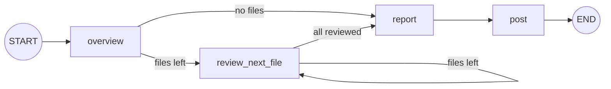

# review-pull-request

LLM-powered code review for GitHub Pull Requests. Analyses each changed file in two stages using a fast inference API, then posts the findings as a PR comment.

## Quick Start

```bash
# Full review — reviews all changed files
mesh review-pull-request https://github.com/org/repo/pull/123

# Incremental review — only reviews changes since the last AI review
mesh review-pull-request https://github.com/org/repo/pull/123 --since-last-review

# Dry run (mocked LLM, no PR comment posted)
mesh review-pull-request https://github.com/org/repo/pull/123 --dry-run

# Review but don't post a comment
mesh review-pull-request https://github.com/org/repo/pull/123 --no-post-comment

# Failed, hung or killed? Run the same command again: it resumes from the file it stopped at
mesh review-pull-request https://github.com/org/repo/pull/123

# Review the same commit again from scratch, discarding the saved progress
mesh review-pull-request https://github.com/org/repo/pull/123 --force-rerun
```

## Prerequisites

- `gh` CLI installed and authenticated (`gh auth login`), or a `GITHUB_TOKEN` environment variable
- `.env` file populated with `CODE_REVIEW_URL`, `CODE_REVIEW_TOKEN`, `CODE_REVIEW_MODEL`
- AWS credentials for the checkpoint store (DynamoDB + S3, see [Checkpoint infrastructure](#checkpoint-infrastructure-aws-cdk)):
  on the dev EC2 the SSO `dev-EC2` permission set (`aws sso login` when the session expires). Without
  them the run stops before reviewing anything. `--dry-run` needs no AWS.

```bash
cp .env.example .env
# edit .env with your API credentials
```

## Run from any directory — no local clone needed

All `read_file` calls go directly to the GitHub API at the PR's exact head commit SHA. No local checkout of the target repo is required.

```bash
# From any directory
cd ~
mesh review-pull-request https://github.com/org/repo/pull/123
```

**How it works:** after fetching PR info, the tool creates a `GitHubFileReader` authenticated with `gh`'s stored token. When the LLM calls `read_file`, it fetches the file via the GitHub raw content API at `?ref=<head-sha>` and caches the result in memory for the duration of the run.

**Rate limits:** the GitHub API allows 5,000 authenticated requests/hour. Results are cached per run so each unique path+truncation pair is fetched at most once.

## How It Works

### Why a graph?

A review is a long chain of slow, failure-prone model calls: one overview, then one call (or more)
per file, then a report and a post. Run as a plain loop, any failure meant starting again from
file 1 and paying for every call twice. As a LangGraph `StateGraph` each step is a node, and a
checkpoint of the typed state is saved after every node, so a run that dies resumes at the file it
stopped at, possibly on another model. The graph also makes the flow explicit: the conditional edge
after each file decides "next file or report", and nothing outside the state survives a crash by
accident. The graph runs with `stream_events` (v3), so node events are available while it runs
(`--verbose` prints `node: <name>`) for per-call timing (PMAT-262) and live progress later.



State (`graph.py` `ReviewState`): `files`, `overview`, `overview_model`, `results` (one entry per
reviewed file) and `report`. No diff, file contents or prompts are stored.

### Stage 1 — Overview

The full PR diff is sent to the LLM to produce a high-level narrative of what the PR does. This is used as context in Stage 2.

### Stage 2 — Per-file review

Each changed file is reviewed individually. The LLM receives:
- The file's diff chunk
- The Stage 1 overview as context
- The ability to call `read_file` to inspect other files for cross-reference (local or remote)

Issues are classified as `high`, `medium`, or `low` severity.

### Trace

Every review (except `--dry-run`) writes a **trace** (PMAT-325): one JSONL file holding each `read_file`
call (name and arguments) and its result exactly as the model received it, in order, with one span per
file review. It is recorded inside the redactor, so excluded files appear only as refusals and tokens as
`[REDACTED]`. The records are shaped like Langfuse observations, so Langfuse can replace the file later
(PMAT-262). `mesh review-pull-request` writes it to `~/.mesh/review-traces/<thread hash>.jsonl` (in CI, under
the job's HOME); the evals write it to their run folder. A resumed review appends to the same file, and
`--force-rerun` starts it again. The trace never goes into the checkpoint store.

### Report

A Markdown report is printed to stdout and (unless `--no-post-comment`) posted as a GitHub PR comment. The comment header is:

```
# AI Code Review (full review of abc1234)

> **Reviewed commit:** `<full SHA of the PR head>`
```

With `--since-last-review`, when new commits are found:

```
# AI Code Review (since last review: abc1234..def5678, 2 new commit(s))

> **Reviewed commit:** `<full SHA of def5678>`
> **New commits:** `1a2b3c4` · `def5678`
```

If `--since-last-review` falls back to a full diff, the header says `(full review of …)`. The `Reviewed commit` line is where the next `--since-last-review` run starts from.

The comment footer identifies the tool: `Generated by mesh review-pull-request`.

### Running the agent, and the PR adapter

`run_review_agent(owner, repo, base_sha, head_sha, pr_description, ...)` in `review.py` runs the
agent: it reviews the compare diff `base_sha...head_sha` (three-dot, from the merge base) with files
read at `head_sha`, and never posts. `main()` is the PR adapter: it resolves the PR URL to those
values (`baseRefOid`, `headRefOid`, the PR body), picks the base for `--since-last-review`, and owns
posting, the "not reviewed" notice and the output flags. The evals call the same function (PMAT-304).

A full review's diff comes from the compare API `baseRefOid...headRefOid`, not `gh pr diff`; on 12
real merged PRs (up to 93 files) the two are byte-identical. A diff with 300 or more files (the
compare API's limit) fails the review instead of reviewing a possibly truncated diff.
`scripts/parity/diff_parity.sh` ran that check for the PMAT-314 refactor and can be deleted later.

## Flags

| Flag | Description |
|------|-------------|
| `--since-last-review` | Only review commits added since the last AI review comment |
| `--force-rerun` | Discard the saved progress of this review (same PR, commit, mode and exclusions) and start again |
| `--base <branch>` | Diff against this branch (default: `master`) |
| `--dry-run` | Mock LLM responses; skip posting to PR |
| `--no-post-comment` | Run the review but don't post the result to GitHub |
| `--no-output` | Suppress stdout output (useful with `--no-post-comment` in CI) |
| `--hide-pr-comment` | Post to PR but don't print the report to stdout |
| `--verbose` | Print detailed logs to stderr |
| `--model <name>` | Override `CODE_REVIEW_MODEL` from `.env` |
| `--config <path>` | Custom TOML config file (default: `review_config.toml`) |
| `--repo-path <path>` | Local repo path (default: current directory) |

## Excluding files: `.pr-review-ignore`

Files matching the patterns in `alpha-mesh/.pr-review-ignore` are not reviewed. It is one global list (it applies to every repo the agent reviews), read from the alpha-mesh root and merged with `[exclusions] patterns` in `review_config.toml`.

- one pattern per line; blank lines and lines starting with `#` are ignored
- a missing file means no extra exclusions
- `**/name` matches `name` at any depth, including the repo root
- lines follow gitignore path semantics (`dir/`, `/anchored`, `a/**/b` also matching `a/b`); `[exclusions] patterns` get the same treatment
- a renamed or copied file is excluded if either its old or new path matches

Default list:

```
**/CLAUDE.md
**/README.md
**/.claude/*
**/.mesh/*
**/.env
**/.env.*
**/.envrc
**/config/active.json
```

## read_file caching

While reviewing a file the model can call `read_file` to look at other files. Results are cached for the run: a file read once is served from memory to later file reviews (logged as `(cached)`), and a repeat request inside the same file review gets a short "already read" note instead of the content. Error results are never cached. A path that comes back "not found" is not retried within the same file review: the model gets a firm "does not exist; do not request it again" note instead (logged as `(not found, repeated — not re-read)`), which still counts toward the read limit. The first "not found" lists files anywhere in the repo with the same name (e.g. `pkg/x.py` → `src/pkg/x.py`) and the contents of the nearest folder that exists, so a path missing `src/` shows a folder containing `src/`. Each file review's prompt also lists the files in that file's own folder, so the model doesn't have to guess names like `stages.py` for `stage1.py`. The repo file list is fetched once per run at the PR head commit (one GitHub API call). Excluded files are removed from it before anything reaches the model, and a folder that holds only excluded files is never shown. If the list can't be fetched (or GitHub truncates it), it is not retried: reviews run without it, `(file listing unavailable …)` is logged, and the report says so. A path the model asked for that does not exist is listed in the report under "Paths not found", with the file whose review asked for it, unless the model recovered from it: by the end of that file review it had read one of the suggested paths, or a suggestion was the file under review. A path recovered in one file review but not in another is listed only for the review that did not recover. If every miss was recovered, the section is left out. The console log still shows every miss. A folder path reads as "not found", as it would locally: GitHub answers a folder with a JSON listing whose entries carry signed download URLs (credentials) and name excluded files, so that listing is never passed on. Symlinks are never listed or followed; the report warns about them under "Symlinks in the repository", since they are a hidden dependency. File names containing control, format or line-separator characters are dropped from the list. Failed reads are logged as `(not found; suggested: …)` or `(failed: …)`. Other errors, such as a rate limit, can still be retried. Total cached content is capped at 50 MB; once full, files are still served but no longer stored. The cache is cleared when the run exits, so nothing persists between runs.

## Incomplete and fully excluded reviews

- A report with incomplete files carries the heading "Partial pull request review" (not the `# AI Code Review` marker), so it is never used as a `--since-last-review` baseline.
- If the model gives no usable answer for a file (unparseable reply, tool-call limit reached), that file is listed in the report under "Not fully reviewed", the "No issues found ✅" all-clear is withheld, and the run exits non-zero (the report is still posted).
- If every changed file matches an exclusion pattern, the agent says so on stderr and posts a short comment stating that the PR was **not** reviewed, instead of exiting silently. Nothing is posted with `--no-post-comment` or `--dry-run`.
- If the review (or the "not reviewed" notice) could not be posted to the PR, the run exits non-zero instead of reporting success.
- A mixed PR's report lists the changed files that were skipped by exclusion patterns under "Excluded from review", so the all-clear never implies coverage it lacks. The "not reviewed" notice does not carry the `# AI Code Review` marker, so `--since-last-review` never mistakes it for a completed review.
- An unreadable `.pr-review-ignore` aborts the run (it would otherwise send files you meant to exclude).
- A `!` (negation) line in `.pr-review-ignore` or `[exclusions] patterns` aborts the run: negation is not supported. `[exclusions] patterns` that is not a list of strings aborts too.
- A finding whose fields have the wrong types (e.g. `"file": null`) is dropped and its file listed under "Not fully reviewed". A `read_file` call without a string path, or a call to any other tool, gets an error reply.
- `--since-last-review` falls back to a full review when GitHub's compare API cannot list the whole range (over 250 commits, or 300 or more changed files).
- A report over GitHub's comment size limit is cut in its findings; the header and the closing sections ("Not fully reviewed", "Excluded from review", …) are kept.
- Severities other than high/medium/low from the model (`error`, `critical`, `warning`, anything else) are mapped to high/medium/low so no finding is dropped from the report.
- Each finding's heading starts with its ID, `R<PR>-<reviewed commit, 7 chars>-<number>` (e.g.
  `R31-e0c98f3-003`), numbered 001, 002, … in the order the report prints them. A commit that fixes a
  finding cites its ID (PMAT-305). A later review that raises the same issue gives it a new ID. There is
  no `#` before the PR number, because GitHub would turn it into a link.

## Excluded files stay away from the model

See [DESIGN-PATTERNS.md](DESIGN-PATTERNS.md) for how this is enforced in one place (PathPolicy, SafeDiff, PolicyFileReader, GuardedLLM, ReviewSession) and how the end-to-end canary test proves it.


Exclusion matching is case-insensitive (`.ENV` is excluded like `.env`). Exclusion patterns apply to the diff **and** to the `read_file` tool: if the model asks for an excluded path (including tricks like `src/../.env`), it gets a refusal instead of the content, so a prompt-injected instruction cannot pull `.env` or `.claude/settings.json` into the conversation. Token-bearing paths (`**/.env`, `**/.env.*` (so `.env.example` too), `**/.envrc`, `**/.claude/*`, `**/.mesh/*`, `**/config/active.json`) are built in and always excluded, even if `.pr-review-ignore` is missing or misplaced. Lines in `.pr-review-ignore` may use gitignore-style `dir/` (matched at any depth), bare names (`secrets.json`, `node_modules`: file or directory, at any depth), a leading `/` or a slash inside the pattern (relative to the repo root; a literal path also covers the directory's contents) and trailing ` # comments`. Excluded files are also left out of the overview prompt, not only the per-file reviews.

## Report size

GitHub rejects comments over 65,536 characters, so a report longer than 65,000 is truncated with a visible note (a warning is printed) instead of failing to post.

## Failure behaviour

If an LLM API call fails (for example a `404` because the model in `CODE_REVIEW_MODEL` is not available), the review **aborts**. The agent never posts partial results and never posts a "No issues found" comment for files it could not review. The files already reviewed are saved: run the same command again to resume (see [Resuming a review](#resuming-a-review)).

On failure it:

- prints the error, the step or file being reviewed, the model and the API host to stderr (the token is never printed)
- tells you to check `CODE_REVIEW_MODEL` / `CODE_REVIEW_URL` / `CODE_REVIEW_TOKEN` in `.env`
- posts nothing to the PR
- says how much completed work is kept (`Completed work is kept: overview + N file(s)`)
- exits with a non-zero code (`1`)

Retries before giving up (PMAT-236; one retry loop in `llm.py`, the SDK itself never retries).
Every failed model call is classified:

| Class | What | Attempts |
|---|---|---|
| timeout | no reply data for 60 s (hung), or still running after 15 minutes | 2 |
| transient | `408`, `429`, `5xx`, connection errors; error objects saying timeout, rate limit, overloaded or temporarily unavailable (e.g. "Upstream idle timeout exceeded") | 6 |
| credits | `402`, or a credits/quota error (also a `429`, e.g. OpenRouter admission control) | 1: fails at once, "add credits" |
| permanent | other `4xx` (`400`, `401`, `403`), other error objects (e.g. `context_length_exceeded`) | 1 |

Replies are streamed. Keep-alive padding and `: comment` lines do not count as reply data, so a provider
that keeps a stalled call open is still cut off. A slow reply that keeps sending data is not cut off
until the 15-minute per-call deadline (free models can stream for 3 minutes or more). Waits between attempts are exponential with jitter (about 2, 4, 8 … s,
capped at 60 s). A `Retry-After` header is honoured, also capped at 60 s. No retry starts once one call has
spent 15 minutes in total (the attempt in flight may run past it, up to its deadline; so a call
that reaches the deadline is not retried). Each retry is logged to stderr, e.g.
`retrying in 8s (attempt 3/6): transient: provider error: Upstream idle timeout exceeded`.
A malformed reply (including an empty stream with no finish reason) is retried up to 3 times. A `404` on a call with tools (on
OpenRouter: no provider that supports tool calls is reachable for the model right now) is retried
twice **with tools**; there is no fallback without tools, because without `read_file` the review would
silently be weaker. After the third `404` the error names the model, the host, the provider's reply and the fix
(`--model <provider/model>` with a model that supports tool calls). On any other host a `404` stops the
review at once: the error shows the full URL called (without credentials), the model as configured and as
sent, and the naming rules below.

`--dry-run` runs the same review graph with a scripted model (no model API call, nothing posted).

## Resuming a review

Progress is saved after the overview and after each file (LangGraph checkpoints in DynamoDB/S3). A
review that fails, hangs or is killed (Ctrl-C, `kill -9`, a reboot) is resumed by running **the same
command** again:

```
Resuming: 5 file(s) from checkpoint, 15 to review (thread review-pull-request:org/repo#123:<sha>:full:<hash>)
  From checkpoint: src/a.py, src/b.py, ...
  To review now: src/f.py, ...
```

- **What identifies a review (the thread):** PR, head commit, mode (`full` or `since-<base commit>`) and
  the exclusion patterns. A new commit, another incremental base or changed exclusions start a new
  review; nothing stale is reused. The model is *not* part of it.
- **Switching model on resume:** `--model` may name another model. Files already reviewed keep their
  result; the report header lists every model used (`**Models:**`), and each issue names the model
  that found it (``#### R31-e0c98f3-003 · `src/x.py` · line 42 · model: `z-ai/glm-5.3-flash` ``; the overview names its model too).
  *Files reviewed* lists each fully reviewed file with its model (path and model only).
- **Free-model workflow:** review a large PR on a free model; when it throttles after file 5 of 20,
  rerun (same or another free model) until every file is done. Low token cost, more wall-clock time.
- **A model without tool calls** fails on the first file (the overview is kept); resume with
  `--model <provider/model>` that supports tools.
- **The file in flight** when a run died has no result and is reviewed again; a half-finished file is
  never reported.
- **The PR's files changed under the same commit** (e.g. the PR was retargeted to another base): the
  rerun refuses, whether the review was mid-run or finished (`the PR's changed files differ from the
  saved review`), and asks for `--force-rerun`.
  Known limitation: only the list of files is compared, so a retarget that keeps the same files but
  changes their diffs is not detected. After retargeting a PR to another base, run with `--force-rerun`.
- **Finished reviews:** running a completed review again prints the stored report and posts nothing
  (`Already completed (thread …)`). Files marked incomplete stay incomplete: use `--force-rerun` to review
  the commit again from scratch.
- **One run per review at a time:** a second run of the same review on this machine exits with
  `ERROR: another review is running on this thread (pid N)`. The lock (`~/.mesh/locks/`) is released when
  the process ends in any way, `kill -9` included, so a killed run can be resumed at once. It does not
  protect against a run on another machine.
- **A rare duplicate comment:** posting and saving the "posted" checkpoint are two steps. If the run is
  killed between them (or GitHub's reply is lost), the resume posts the same report again. Delete the
  extra comment by hand; `--since-last-review` is unaffected (both name the same commit).
- **Expiry:** saved progress expires after `checkpointTtlDays` (default 2 days); after that the next
  run starts fresh.
- **What is saved:** results only: file paths, the model's overview, each file's summary and findings,
  missing paths, the report, model names and counts. No diff, no file contents, no prompts
  (`tests/test_canary.py` scans the store for planted secrets).

### Demo: kill and resume

```bash
# 1. Start a review and kill it hard while a file is in flight
mesh review-pull-request https://github.com/org/repo/pull/123 --no-post-comment &
# wait for "[3/10] reviewing ..." then:
kill -9 %1

# 2. Run the same command again: finished files come from the checkpoint
mesh review-pull-request https://github.com/org/repo/pull/123 --no-post-comment
#   Resuming: 2 file(s) from checkpoint, 8 to review (thread review-pull-request:org/repo#123:...)

# 3. Look at the saved checkpoints (thread id from the "Starting review (thread ...)" line)
TABLE=$(aws ssm get-parameter --name /pmat/dev/alpha-mesh/review-pull-request/checkpoint-table \
        --query Parameter.Value --output text)
aws dynamodb query --table-name "$TABLE" --key-condition-expression "PK = :pk" \
    --expression-attribute-values '{":pk": {"S": "CHECKPOINT_<thread id>"}}' --query "Items[].SK"
```

`scripts/smoke-resume.sh` runs the same check end to end with real models (kill, then resume on a
second model). **Ctrl-C** exits at once with code `130` and the hint to rerun: the graph's nodes run
on a worker thread that a signal cannot stop, so the run does not wait for the model call in flight
(that file is reviewed again on resume).

### Known limitations

- **One machine only.** The run lock (`~/.mesh/locks/`) does not stop a run of the same review on another machine.
- **A rare duplicate comment** when a run is killed between posting and saving that it posted; delete
  the extra comment by hand.
- **Retargeted PRs:** a rerun compares only the list of changed files with the saved review, so a
  retarget that keeps the same files but changes their diffs is not detected. Use `--force-rerun` after
  retargeting a PR to another base.
- **A new commit re-reviews every file.** Results are not reused for files unchanged between two head
  commits; `--since-last-review` is the way to review only new changes.
- **Incomplete files are not retried.** A finished review stays finished; `--force-rerun` reviews the
  commit again from scratch (retrying only incomplete files is PMAT-271).
- **A lost "not fully reviewed" warning:** if a run is killed after the report is built but before it
  is posted, the resume posts the report (which still lists incomplete files) but does not print the
  warning on stderr and exits 0 instead of 1.
- **AWS credentials must stay valid for the whole run.** If the SSO session expires mid-run, the next
  checkpoint write fails and the run stops; `aws sso login`, then rerun to resume.
- **Saved progress expires** after `checkpointTtlDays` (default 2 days); the next run starts fresh.
- **The checkpoint secret scan runs on SQLite only.** `tests/test_canary.py` scans a `SqliteSaver` store, not
  the real DynamoDB table and S3 bucket; their compression and S3 offload store the same bytes
  (accepted residual risk, spec 5.2).
- **Model naming:** model ids with a real `/` off OpenRouter, and base URLs that must not end in `/v1`,
  are not supported (PMAT-276, see [Environment Variables](#environment-variables-env)).

## --since-last-review (Incremental Mode)

When iterating on a PR, re-running a full review after each fix is slow and noisy — it re-flags issues you already addressed. The `--since-last-review` flag solves this:

1. **Finds the last review comment** — scans PR comments for the `# AI Code Review` signature, posted by the same GitHub account the tool posts as (a look-alike comment from anyone else is ignored)
2. **Reads the commit it reviewed** — from its `Reviewed commit` line
3. **Builds an incremental diff** — from that commit to the PR head, so every commit after it is covered, whenever it was made
4. **Reviews the incremental diff** — same Stage 1 + Stage 2 pipeline on the smaller diff
5. **Posts** — comment header indicates it is an incremental review

### Fallback behaviours

| Condition | Behaviour |
|-----------|-----------|
| No previous review comment found | Falls back to full review; prints `No previous review found — running full review.` |
| Last review records no commit (older comment format) | Falls back to full review |
| No new commits since last review | Exits immediately; prints `No new commits since last review (abc1234). Nothing to review.` |
| History rewritten (force-push or rebase), or the compare API fails | Falls back to full review with a warning |
| Incremental diff is empty | Falls back to full review with a warning |

### Example workflow

```bash
# First review (full)
mesh review-pull-request https://github.com/org/repo/pull/42

# Push fixes, then re-review only the new changes
git push origin feature/my-branch
mesh review-pull-request https://github.com/org/repo/pull/42 --since-last-review
```

## Configuration

`review_config.toml` (next to the agent; `--config` overrides it, and a `--config` path that does not exist aborts the run) controls exclusion patterns, per-file line limits, and model overrides:

```toml
[limits]
max_tool_calls = 20   # file reads per file review; at the limit the model is asked for its answer
max_file_lines = 8000

[exclusions]
patterns = [
    "*.lock",
    "pnpm-lock.yaml",
    "*/node_modules/*",
    "*/dist/*",
]
```

## Environment Variables (`.env`)

The agent reads `.env` from the alpha-mesh root (next to `bin/mesh`) by explicit path, in Python
(`python-dotenv`), so `mesh review-pull-request` and `python -m review_pull_request` load it the same way
from any directory. The bash wrapper does not read it. Rules:

- One `KEY=value` per line; no shell syntax (`export`, `$(...)`, unquoted spaces).
- A variable already set in the environment wins over the file.
- A missing `.env` or an unset variable below stops the run with an error naming the `.env` path.
  `--dry-run` still reads `.env` but needs neither: unset variables get placeholder values.

| Variable | Description |
|----------|-------------|
| `CODE_REVIEW_URL` | Base URL of the LLM API (e.g. OpenRouter endpoint) |
| `CODE_REVIEW_TOKEN` | API token / bearer token |
| `CODE_REVIEW_MODEL` | Model used for the whole review, both the overview pass and the per-file reviews (e.g. `deepseek/deepseek-r1`); `--model` overrides it |

Model names use `{provider}/{modelname}` (the OpenRouter standard, e.g. `openai/gpt-oss-120b`). For
`openrouter.ai` the full name is sent; for any other endpoint (OpenAI, MiniMax, Ollama, Anthropic's
OpenAI-compatible API) the `provider/` prefix is stripped. A name without `/` is sent unchanged.
`/v1` is appended to `CODE_REVIEW_URL` if missing. Not supported yet (PMAT-276): model ids with a real
`/` off OpenRouter (e.g. vLLM's `meta-llama/Meta-Llama-3-8B-Instruct`) and base URLs that must not end in
`/v1` (e.g. `.../v1beta/openai`); both end in a `404` that names the cause. Every endpoint is called through LangChain's
`ChatOpenAI`, with the key and URL from `.env` (never a provider-specific variable such as `OPENAI_API_KEY`).

At startup the agent prints the model and API URL it is using to stderr, so you can confirm which `.env` values took effect. The token is never printed.

Checkpoint store (optional; the defaults suit the dev EC2):

| Variable | Description |
|----------|-------------|
| `DEPLOY_ENV` | Environment whose SSM parameters name the table, bucket and TTL (default `dev`) |
| `AWS_REGION` | AWS region (default `eu-west-1`) |
| `ALPHA_MESH_REVIEW_PULL_REQ_CHECKPOINT_TABLE` | Overrides the table name from SSM |
| `ALPHA_MESH_REVIEW_PULL_REQ_CHECKPOINT_BUCKET` | Overrides the bucket name from SSM |

## Tests

Requires Python 3.12 (pinned in `.python-version`; newer versions are problematic with the LangGraph modules).

```bash
cd agents/review-pull-request
uv run pytest tests/ -v
```

The review runs as a LangGraph graph (`graph.py`: overview → one step per file → report → post),
calling the stage 1 and stage 2 code unchanged. `graph.run_review` runs it with `stream_events`
(v3) instead of `invoke`; `tests/test_streaming.py` checks the node order and that the report is the
same as with `invoke`, and `tests/test_canary.py` records every stream event to check that no
excluded content passes through them. Conventions: `alpha-mesh/CLAUDE_LANGGRAPH.md`.

`tests/test_resume.py` runs the CLI in a subprocess (`tests/fixtures/run_review.py`: a `SqliteSaver`
file, a fake model and fake GitHub), kills it (`SIGKILL`/`SIGINT`/`SIGTERM`, hung model calls) and
resumes it. The integration test against the deployed DynamoDB/S3 store runs only on request, needs AWS
credentials and deletes its thread afterwards:

```bash
RUN_AWS_INTEGRATION=1 uv run pytest tests/test_integration_checkpoints.py -v
```

End-to-end check with real models, run by hand (nothing is posted): start a review with model A,
`kill -9` it once file K (default: the last file) is in flight, resume it with model B, and check the resume kept files 1..K-1
and the report names both models. Output goes to `~/environment/logs/ai/claude/smoke-resume-*/`.

```bash
scripts/smoke-resume.sh https://github.com/org/repo/pull/123 z-ai/glm-5.3-flash nvidia/nemotron-3.5-lightning:free
```

## Eval cases and evals

`eval/` mines eval cases from merged PRs, with no model calls: a high or medium finding whose ID a PR
commit cites is a real issue, and one a PR comment dismisses by ID is a false positive (PMAT-307). It does not change
the review code; see [eval/README.md](eval/README.md).
`eval/scripts/run_eval.sh` runs the agent on every case's commit with Promptfoo (PMAT-304), through the same
`run_review_agent`, and `eval/baseline.json` records the result; see [eval/README.md](eval/README.md#running-the-evals).
Its tests (`eval/tests/`) run with the suite above.

## Checkpoint infrastructure (AWS CDK)

Storage for resumable reviews (PMAT-237): every non-dry run saves its progress here (see
[Resuming a review](#resuming-a-review)).

`infra/cdk` deploys `PmatAlphaMeshReviewCheckpointsStack-{env}`:

| Resource | Details |
|----------|---------|
| DynamoDB table `pmat_{env}_ALPHA_MESH_REVIEW_CHECKPOINTS` | `PK`/`SK` strings, on-demand, TTL attribute `ttl` |
| S3 bucket `pmat-{env}-alpha-mesh-review-checkpoints-{account}` | Public access blocked, SSE-S3. No lifecycle rule in the stack: `DynamoDBSaver` adds its own `ttl-days` rule |
| SSM `/pmat/{env}/alpha-mesh/review-pull-request/checkpoint-table`, `…/checkpoint-bucket`, `…/checkpoint-ttl-days` | Names the agent reads at runtime |

- TTL: `checkpointTtlDays` in `infra/cdk/cdk.json` context, per environment (default 2).
- Dev destroys the table and bucket on teardown; staging and prod retain them.
- The stack creates no IAM access: the agent runs on EC2 through the SSO `dev-EC2` permission set,
  like the PMATFE-mfe-* projects.

It also deploys `PmatAlphaMeshReviewEvalRunsStack-{env}` (PMAT-336). It's a separate stack, so a checkpoint teardown can't
touch it:

| Resource | Details |
|----------|---------|
| S3 bucket `pmat-{env}-alpha-mesh-eval-runs-{account}` | The eval runs that committed files depend on (`eval/scripts/archive_runs.py`, [eval/README.md](eval/README.md#archived-runs)). Retained in every env, no auto-delete. Public access blocked, SSE-S3, versioned. Noncurrent versions expire after 30 days, expired delete markers and incomplete uploads (7 days) are cleaned up |
| SSM `/pmat/{env}/alpha-mesh/review-pull-request/eval-runs-bucket` | The bucket name the script reads |

Deploy to dev (needs `aws sso login`, Node and pnpm):

```bash
agents/review-pull-request/scripts/deploy-dev-from-ec2.sh
```

CDK assertion tests:

```bash
cd agents/review-pull-request/infra/cdk
pnpm install && pnpm test
```
